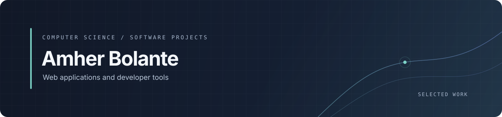

  

  Computer Science student · Software developer 
  Building useful applications and developer tools with care.

  <a href="https://github.com/amherryyy">GitHub</a>

---

## Selected work

| Project | What it is | Built with |
| --- | --- | --- |
| [Duno](https://github.com/amherryyy/Talas) | Study planning, tracking, and academic analytics. Repository name: `Talas`. | PHP · CodeIgniter 4 · MySQL |
| [Flower](https://github.com/amherryyy/Flower) | A framework for validating and evolving structured software projects. | TypeScript · Node.js · PostgreSQL |
| [RoomScouter](https://github.com/amherryyy/RoomScouter) | A mobile-first pilot for finding and comparing student boarding houses. | TypeScript · Next.js · Supabase |

## Tools I use

**Languages**  PHP · TypeScript · JavaScript · SQL  
**Frameworks**  CodeIgniter 4 · Next.js  
**Data**  MySQL / MariaDB · PostgreSQL · Supabase  
**Workflow**  Git · npm

The technologies listed are drawn from these projects; they are not proficiency rankings.

---

Learn continuously · Build with care · Improve through feedback

